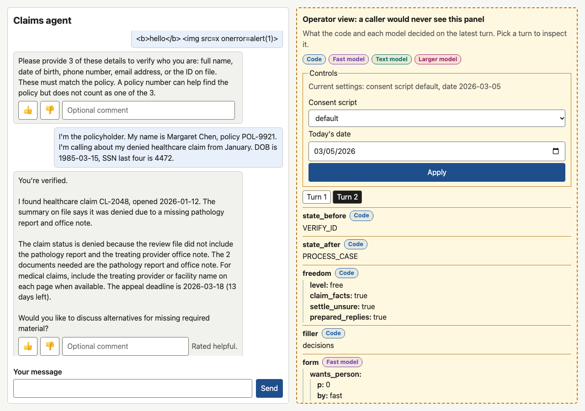

# Insurance claims support agent with an SOP harness

A chat agent for insurance claim support that follows a fixed operating procedure:
verify the caller, work out what they need, answer from the claim record, then wrap up.
Language models read the caller's messages and word the replies; plain code makes every
decision about state, access and what a reply is allowed to say.

## Run it

You need Docker and an OpenAI API key.

```bash
cp .env.example .env        # then set OPENAI_API_KEY in .env
docker compose up --build
# open http://localhost:8000
```

Every start rebuilds the database and reloads the sample data, so earlier conversations
are cleared. The first start also builds the image. The sample data is in
`data/starter/`. The page has the chat on the left and an
operator panel on the right that shows what was decided on each turn and by what
(code, the fast model, the text model, or the larger model). A caller would never see
that panel.



## Try this

1. The full flow in one message:

   > I'm the policyholder. My name is Margaret Chen, policy POL-9921. I'm calling about
   > my denied healthcare claim from January. DOB is 1985-03-15, SSN last four is 4472.

   The agent verifies her (three or more of five identity details match one customer),
   finds the one claim that fits, and answers from the record: status, denial reason,
   documents needed, appeal deadline. Then ask "what if I can't get the pathology
   report?", then "that's all", and accept the summary email.

2. A frustrated caller who has not verified:

   > I already told you who I am. This is ridiculous. Just tell me why my claim was denied.

   The agent acknowledges the frustration, explains that claim details are protected
   until the caller is verified, says which details it can accept, and discloses
   nothing. Repeat the demand and it offers to pass you to a person ("yes" hands over).
   Give "Margaret Chen, born 1985-03-15, SSN ends in 4472" instead and you are verified
   and answered in the same turn.

3. Several questions at once, once verified: "why was it denied, and when do I need to
   send the documents?" Up to three questions in one message are each answered in the
   same reply.

4. Which claim: "what about my other claims?" lists the ones that match and asks which.
   Answer by pointing ("the second one", "the newer one") or by describing it.

5. Totals and comparisons, once verified: "how much was I paid in total across my
   claims?" The database does the sum over the caller's own claims and the reply states
   only that figure; no model does arithmetic.

6. Out of scope: "what is reinforcement learning?" is declined politely. Ask for a
   person at any point and the agent offers a hand-over.

## How a turn works

```
caller message
   -> a fast model fills in a fixed form about the message   (yes/no and pick-one questions, each with a confidence)
   -> a text model pulls out stated values                   (name, date of birth, policy number, ...)
   -> code reads the form and decides                        (state changes, which claim, which facts may be said)
   -> a text model words a reply from those facts only
   -> code checks the reply against the facts before sending (a failed reply is rewritten once, then replaced by a fixed text)
```

No model ever decides to move the conversation forward, and no model is given anything
about a claim until the database has verified the caller.

Every turn also stores a list of events: what each model was asked and answered, and what
each rule decided. They are shown in the operator panel, masked the same way as the rest
of it, and one conversation cannot read another's.

### The states

| State | What happens | Freedom |
|---|---|---|
| `VERIFY_ID` | At least three of these five must match one customer: full name, date of birth, phone, email, last four ID digits. A policy number helps find the policy but does not count toward the three. The database does the matching. Three wrong values hand over to a person. | Strict. |
| `AWAIT_CONSENT` | Someone calling for a policyholder waits here until the policyholder's consent is recorded. | Strict. |
| `RESOLVE_INTENT` | Works out which claim the caller means (type, status, month, year, a claim number, or a pick from a short list) and what they need. | Free. |
| `PROCESS_CASE` | Answers from the claim's own row and the guidance data, offers one follow-up at a time, gives alternatives when a document can't be obtained, and hands over when the alternatives run out. | Free. |
| `POST_PROCESS` | "Anything else?", an optional summary email to the address on file, close. | Guided. |

The freedom level is a setting per state (`[states.<NAME>] freedom` in `settings.toml`),
and each level is three switches (`[freedom.<level>]`):

| Level | Claim facts may reach a model or a reply | An unsure reading is settled by the larger model | Replies may be prepared ahead |
|---|---|---|---|
| strict | no | no | no |
| guided | yes | no | no |
| free | yes | yes | yes |

In every state, code alone decides state changes and builds the facts; the level only
changes how much the models are trusted to interpret.

Rules that apply to every message, in any state: a request for a person, an upset or
angry caller, an unreadable message, an off-topic question, and a caller who is going in
circles.

### How the database guards claims

The server connects with an account that cannot read the claims tables at all unless the
conversation has been verified. Verification is a database function: it compares the
details the caller gave with the customer table and, only on a match, records the
verified customer on the conversation. A row-level rule on the claims tables then
returns only that customer's rows to that conversation. So "show me someone else's
claim" fails in the database, not just in the prompt, and a claim number that belongs
to another customer looks exactly like one that does not exist.

A conversation's own history (its turns, summaries and hand-over notes, which repeat claim
facts once a caller is verified) is kept apart from other conversations by the server's
queries; the database-level rule covers the claims tables, the event records and prepared
replies.

The email address used for the summary never leaves the database. The agent refers to
it only as "the email on your policy".

### Models

| Job | Model |
|---|---|
| Fill the form (OpenAI Decisions API; about 40 questions before verification and more once claims are in focus, in one request) | `gpt-6-luna` |
| Pull out stated values; word the reply | `gpt-6.1-sol` |
| Rewrite a reply that failed the check; settle a request the fast model was unsure about (each at most once per turn) | `gpt-6-astra` |

Measured on the first message of a conversation: about 0.4 cents and four to six seconds. Model names and thresholds are in `settings.toml` and `thresholds.toml`.

### Why no agent framework

The procedure is a small state machine, and the important property is that code, not a
model, owns every transition. Each state is one function that takes the filled form and
returns the next state and the facts for the reply, which maps directly onto a graph of
nodes and conditional edges if you wanted to move it into a framework later. Keeping it
as plain functions made the access rules easy to test.

### When the fast model is unsure

If the form comes back unsure between two readings of what the caller wants, code tries
the cheap steps first: rule out a reading the claim itself makes impossible, ask the fast
model one focused question, then ask the larger model once. Only if that settles nothing
does the agent ask the caller, naming the two readings. An ending such as a hand-over
always needs a confident answer; an unsure one becomes a question, never an action.

## Tracing and ratings (optional)

Set `BRAINTRUST_API_KEY` in `.env` and every turn is logged to Braintrust (project
`sop-claims-agent`): the caller's message, the reply, and the stored turn record with the
filled form, what code decided and the reply-check result. ID numbers are masked to their
last four digits and email addresses are removed before anything is sent. Thumbs up and
down under each reply are stored locally and attached to that turn's trace. Without the
key nothing is imported and no network call is made, and a Braintrust outage never
affects a caller's turn.

## Learning from reviewed turns (optional)

The agent never changes itself. Nothing a caller types changes how it behaves until a
person has looked at it and approved it.

1. **Tag.** With tracing on, a turn where a form reading was unsure or the reply check
   failed is tagged `needs_review`. Thumbs ratings attach to the turn.
2. **Approve.** A reviewer adds a misread phrasing worth keeping as an approved example,
   either to the Braintrust dataset `approved-examples` or to
   `evals/approved_examples.json`.
3. **Load at the next start.** Approved examples are shown to the form-filling model as
   example phrasings of that option. Each is treated as untrusted text: a known field and
   option, short ordinary text with no line breaks or web addresses, and a cap per option
   and overall. If Braintrust cannot be reached the file alone is used.

The live scenarios can be run as a Braintrust experiment (needs both keys):

```bash
docker compose --profile test run --rm tests python evals/run_braintrust.py
```

It scores each scenario on expectations met, nothing said about a claim before
verification, every number and date grounded in the facts, and tone.

## Replies prepared ahead (optional)

With `[prepared_replies] enabled = true` in `settings.toml`, after each answer the agent
words the replies to the follow-ups it would offer next, in the background, so a common
follow-up comes back at once. A prepared reply passes the same check as a live one before
it is stored, and is used only for a calm caller, a confident reading of a single question,
and only if the claim's record and the facts are unchanged when it is needed; otherwise the
answer is worded live. It is off by default because each turn can then spend up to
`limits.replies_prepared` extra text-model calls on follow-ups the caller may never ask.

## Hosted mode (optional)

Set `HOSTED=1` and the server holds no model key of its own: the page shows a password box
and each visitor uses their own key.

- The key lives only in the page's memory (never in browser storage, a cookie or the
  address), is asked for again after a reload, and is sent only to this server, only with
  a message.
- The server builds that one message's model connection from it and closes it when the
  reply is done. The key is never written to the database, a log, a trace or an event
  record, and no error repeats it.
- Switched off in hosted mode: replies prepared in the background, the demo control, and
  tracing unless the owner sets `HOSTED_BRAINTRUST=1` as well as the Braintrust key.
- It refuses to start on anything but the bundled sample data unless
  `HOSTED_ALLOW_OTHER_DATA=1` is set: anyone can reach a hosted server.
- Each visitor address may start 10 conversations and send 30 messages a minute.

`render.yaml` describes one Docker web service and one private Postgres 17 for Render; no
secret is written in the file. The limiter is in memory, so it suits a single instance.

## Demo control (optional)

For demos, the operator panel can change a verified customer's claim (status, appeal
deadline, documents needed) so you can watch the next reply pick it up; the agent
re-reads claims on every turn. It is off by default. To switch it on, set
`ADMIN_DATABASE_URL` in `.env` to the loader account's address. The server's own account
never gains write access to claims.

## Other data

Point `data.folder` in `settings.toml` at another folder inside the project with the same
six JSON files, and rebuild the image.
The loader checks every row, sets aside what it cannot store, and reports it in the
operator panel instead of failing.

## Tests

```bash
scripts/test.sh                      # the ordinary suite, inside Docker, against a real Postgres
scripts/test.sh tests/unit           # one folder or file
scripts/test.sh -m live              # scripted conversations against the real models (costs a dollar or two)
```

**Ordinary suite, about 1,140 tests, no model calls.** Unit tests for the form, identity
matching, the reply check and the loader, and whole-conversation tests that run every
state against a real database with scripted models. The security tests connect as the
server's own account and try to read another customer's claims.

**Planted faults** (`tests/planted`). Each test makes a model misbehave, or loads bad
data, and asserts that code catches it:

| Fault planted | What catches it |
|---|---|
| The form model answers yes to everything | Only the database matching stated values can verify; no claim rows are visible |
| The text model returns an impossible date and a five-digit ID | The format check holds neither; the caller is asked to restate |
| The form says "no detail given" while a value arrives, or the reverse | The cross-check: nothing is counted and the turn is flagged |
| The wording adds a web address, a phone number, "approved", an amount, or a claim number that is not in the facts | The reply check: one rewrite, then the fixed text |
| A follow-up is picked for a claim it does not apply to | It does not exist for that claim; the reply says it is not on file |
| A follow-up text in the data has an unknown blank | The loader reports it and switches it off; it is never offered |
| The model refuses or leaves out a pick | The cheaper steps run; no guess; the caller is asked |
| The larger model returns an option that was not offered | Rejected; the caller is asked |
| The model picks a claim that was not in the list shown | Ignored; the list is shown again |
| A reset for another person's policy, then a claim question | The database shows zero claim rows |
| A consent row marked approved with no pending customer | The consent check unlocks nothing |
| "Send it" read at 0.62 confidence | Nothing is sent; the offer is repeated |
| A model times out twice | The conversation is handed over |
| One pooled connection serves a verified, then an unverified conversation | The second sees zero claim rows |
| The Decisions call is refused for the key | The second filler takes over; the conversation completes |

**Live suite** (`tests/live`). 58 scripted conversations run against the real models and
are judged by plain checks on what the engine returned (state, who is verified, claims in
focus, facts, the reply-check result) and on the reply text; a model judges only wording
qualities such as tone. Latest run: [58 of 58](docs/live-results.md). The fast model's
readings vary a little between runs, so expect the count to move by one or two. A full
run sends about 150 caller messages. One group at a time:
`scripts/test.sh -m live -k scn_identity` (groups: identity, consent, memory, resolving,
processing, arithmetic, blocked, language, wrapup).

**A thousand claims for one customer.** Generated at test time and loaded through the real
loader. The caller is never shown or sent a thousand of anything: an overview groups, a
long match leads to a narrowing question, and a total names at most five claims and counts
the rest. Measured on the Compose Postgres: a filtered count 16 ms, an overview 60 ms, a
total 95 ms.

## Known limits

- OpenAI only. The form is filled with the Decisions API; if a key is refused access to it, the agent switches on its
  own to a second filler built on Structured Outputs. `/api/meta` and the operator panel show which one is active.
- The operator panel shows what matched during verification. It is a debugging view for
  this demo and must not be shown to callers. Hosted mode still shows it, so hosted mode
  is not ready for a public deployment as it stands.
- A third party who knows three of a policyholder's details and does not say they are
  calling for someone else is verified as the policyholder. That is the three-of-five
  rule as specified.
- A caller whose whole name on file is a single word is asked for their full name once
  and verifies by giving the same name again. A name typed as one run-together word
  ("MargaretChen") is treated the same way and does not match "Margaret Chen".
- The reply check is pattern based (numbers, dates, amounts, claim numbers, status
  words). It catches invented figures and status claims, not every possible misstatement.
- The identity check has no per-caller rate limit; a real deployment needs one.
- Personal details are logged as typed because only sample data is used. Production
  would mask them where turn records are written.
- A message is split into questions by a model, and only after verification; a question
  the split drops cannot be detected by code. Beyond three questions the reply asks for
  the rest in the next message.
- The acknowledging sentence for an upset caller is worded by the model, so it varies and
  can repeat from one turn to the next.
- A rating given with the thumbs is stored but not shown again after the page reloads.
