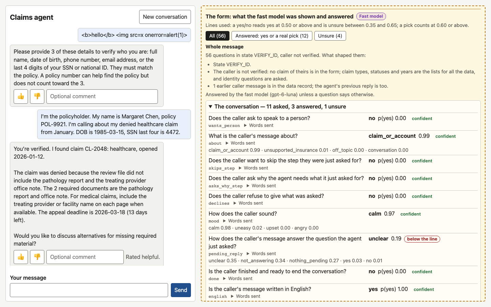

# Insurance claims support agent with an SOP harness

A chat agent for insurance claim support that follows a fixed operating procedure:
verify the caller, work out what they need, answer from the claim record, then wrap up.
Language models read the caller's messages and word the replies; plain code makes every
decision about state, access and what a reply is allowed to say.

## Run it

You need Docker and an OpenAI API key.

```bash
cp .env.example .env        # then set OPENAI_API_KEY in .env
docker compose up --build
# open http://localhost:8000
```

The first start builds the image, creates the database and loads the sample data in
`data/starter/`. By default every start rebuilds the database and reloads the sample
data, so earlier conversations are cleared; set `[data] reset_on_start = false` in
`settings.toml` to keep them. The page is published on this machine only
(`127.0.0.1:8000`).

The page has the chat on the left and an operator panel on the right. A caller would never
see that panel; "Widen panel" gives it most of the window. "New conversation" in the chat
header starts a fresh one at any time; the browser's Back button returns to the previous
one.

Pick a turn in the panel, listed by number and the states it started and ended in, to read
it in the order things happened:

- every model call (job, model, tokens, seconds) and every database action code made; the
  models never call tools;
- the values pulled out of the message;
- every question the fast model was shown in that state, with its answer, how sure it was
  against the thresholds and which model answered it, filterable to the answered or the
  unsure ones;
- the rules that fired;
- the reply's facts, where its text came from and the check result;
- what the agent remembers afterwards.

The raw turn record is at the bottom.



## Who to be

The data is invented, and verifying takes three details that match one customer, so you
need to know whose details to give. The agent treats 2026-03-05 as today. Four to start
with (the page has a collapsed "Sample callers" drawer under the message box that lists
everyone and puts an opening message in the box for you; it does not send it):

| Caller | Name, birth date, ID last four | Phone, email | Try |
| --- | --- | --- | --- |
| Margaret Chen | 1985-03-15, SSN 4472 | +16505212836, margaret@email.com | The full flow below. Her son David Chen is a listed representative. |
| Daniel Okafor | 1978-06-02, SSN 2051 | +16505550101, daniel.okafor@example.com | Two denied healthcare claims: "can I still appeal my denied claim?" makes the agent ask which. One deadline is tomorrow. |
| Priya Nair | 1992-11-09, SSN 7733 | +16505550102, priya.nair@example.com | "How long do I have to appeal?" The auto claim's deadline (2026-02-20) has passed, so no days may be called left. |
| Sam Rivera (two people) | first: 1987-02-14, SSN 1208; second: 1995-09-30, SSN 8365 | first: +16505550104; second: +16505550105 | The name alone is not enough. Give the name and one phone number and nobody is verified; add the birth date and ID and only that Sam is. |

Everyone, with their claims, accepted aliases, representatives and ready-to-send opening
messages, is in [docs/sample-callers.md](docs/sample-callers.md). That page and the
drawer both come from `data/starter/sample_callers.json`, which `python
scripts/sample_callers.py` generates from the data files (a test checks that they match).

## Try this

1. The full flow in one message (as Margaret Chen; other callers are under "Who to be"):

   > I'm the policyholder. My name is Margaret Chen, policy POL-9921. I'm calling about
   > my denied healthcare claim from January. DOB is 1985-03-15, SSN last four is 4472.

   The agent verifies her (three or more of five identity details match one customer),
   finds the one claim that fits, and answers from the record: status, denial reason,
   documents needed, appeal deadline. Then ask "what if I can't get the pathology
   report?", then "that's all", and accept the summary email. A closing "thanks" gets a
   goodbye; nothing is offered twice.

2. A frustrated caller who has not verified:

   > I already told you who I am. This is ridiculous. Just tell me why my claim was denied.

   The agent acknowledges the frustration, explains that claim details are protected
   until the caller is verified, says which details it can accept, and discloses
   nothing. Repeat the demand and it offers to pass you to a person ("yes" hands over).
   Give "Margaret Chen, born 1985-03-15, SSN ends in 4472" instead and you are verified
   and answered in the same turn.

3. A caller who would rather not give a detail: "I'd rather not give my phone number."
   The agent does not ask for it again, says which other details would do, and says
   plainly that nothing about a claim can be shared without three that match.

4. Several questions at once, once verified: "why was it denied, and when do I need to
   send the documents?" Up to three questions in one message are each answered in the
   same reply.

5. Which claim: "what about my other claims?" lists the ones that match and asks which.
   Answer by pointing ("the second one", "the newer one") or by describing it.

6. Totals and comparisons, once verified: "how much was I paid in total across my
   claims?" The database does the sum over the caller's own claims and the reply states
   only that figure; no model does arithmetic.

7. Out of scope: "what is reinforcement learning?" is declined politely and the agent
   returns to where the conversation was. Ask for a person at any point and the agent
   offers a hand-over.

## How a turn works

```
caller message
   -> a fast model fills in a fixed form about the message   (yes/no and pick-one questions, each with a confidence)
   -> a text model pulls out stated values                   (name, date of birth, policy number, ...)
   -> code reads the form and decides                        (state changes, which claim, which facts may be said)
   -> a text model words a reply from those facts only
   -> code checks the reply against the facts before sending (a failed reply is rewritten once, then replaced by a fixed text)
```

The check is plain code. Every number, date, amount, duration and claim number in the reply must be one the facts
hold; web addresses, phone numbers and emails not in the facts are blocked; a status said about a claim must be one
the facts give. It also checks polarity: the reply may not negate what the facts state ("the pathology report is not
required" when the facts list it as needed, "your claim is not denied", "there is no appeal deadline") or state what
the facts about a claim only negate ("it was paid" when the net pay is "not paid yet"). The words guarded this way are
the claim statuses in the data, the wary status words and a short list of obligation words in `settings.toml`
(`[reply_check.polarity_forms]`); a negation that touches none of them ("I can't read out personal details") passes.

No model ever decides to move the conversation forward, and no model is given anything
about a claim until the database has verified the caller.

Every turn also stores a list of events: what each model was asked and answered, and what
each rule decided. They are shown in the operator panel, masked the same way as the rest
of it, and one conversation cannot read another's.

Where to look first in the code: `src/claims_agent/engine.py` runs one turn;
`src/claims_agent/rules/` has one file per state plus the rules that apply to every
message; `src/claims_agent/form/questions.py` is the form the fast model fills;
`src/claims_agent/reply/check.py` is the check every reply must pass; `db/` is the
schema, the accounts and the row rules.

### The states

| State | What happens | Freedom |
|---|---|---|
| `VERIFY_ID` | At least three of these five must match one customer: full name, date of birth, phone, email, last four digits of the SSN or national ID. A policy number helps find the policy but does not count toward the three. The database does the matching. A partial detail is asked for in full; a refused one is not asked for again; three wrong values hand over to a person, and the database itself refuses to compare any more for that conversation. | Strict |
| `AWAIT_CONSENT` | Someone calling for a policyholder gives their own name first, and waits here until the policyholder's consent is recorded. How they say they are related never decides anything. | Strict |
| `RESOLVE_INTENT` | Works out which claim the caller means (type, status, month, year, a claim number, a description, or a pick from a short list) and what they need. | Free |
| `PROCESS_CASE` | Answers from the claim's own row and the guidance data, offers one follow-up at a time, gives alternatives when a document can't be obtained, and hands over when the alternatives run out. | Free |
| `POST_PROCESS` | "Anything else?", then a summary email to the address on file, decided once per conversation, then a goodbye. | Guided |

The freedom level is a setting per state (`[states.<NAME>] freedom` in `settings.toml`),
and each level is three switches (`[freedom.<level>]`):

| Level | Claim facts may reach a model or a reply | An unsure reading is settled by the larger model | Replies may be prepared ahead |
|---|---|---|---|
| strict | no | no | no |
| guided | yes | no | no |
| free | yes | yes | yes |

In every state, code alone decides state changes and builds the facts; the level only
changes how much the models are trusted to interpret.

Rules that apply to every message, in any state: a request for a person, an upset or
angry caller, an unreadable message, an off-topic question, and a caller who is going in
circles. An upset caller who gives up before being verified is offered a person once
before the conversation closes.

### How the database guards claims

The server connects with an account that cannot read claims at all unless the
conversation has been verified. Verification is a database function: it compares the
details the caller gave with the customer table and, only on a match, records the
verified customer on the conversation. A row-level rule on the claims tables then
returns only that customer's rows to that conversation. So "show me someone else's
claim" fails in the database, not just in the prompt, and a claim number that belongs
to another customer looks exactly like one that does not exist.

The same kind of rule covers every table that belongs to a conversation: the
conversation itself, its turns, hand-over notes, summary emails, consent requests,
ratings, event records and prepared replies. A transaction bound to one conversation can
read and change only that conversation's rows, so the copies of claim facts that end up
in a conversation's history are protected the same way as the claims.

The limit on guessing is kept by the database too. The function that compares the details
also decides which of them are wrong and counts each distinct wrong value once, per
conversation, as a fingerprint (the kind of detail and a digest, never the value). The
server's account can read its own conversation's count but cannot add to it, change it or
delete it, and a reset for another person's policy leaves it in place. Once a conversation
has three wrong values, the database refuses every further comparison for it, including
the ones that verify a caller, even when the details are right and even when the functions
are called directly. The turn that gives the third wrong value can still use what that
comparison found, so a caller who gave three right details in the same message is still
verified. The limit is `limits.wrong_values` in `settings.toml`, fixed into the schema when
it is built.

What counts as a full name, and whether two names match, is also decided by one database
function, in any script. Accents are ignored when comparing ("Jose Garcia" matches
"José García").

There are four database accounts: an owner for the schema, a loader for the data files,
the server's own account, and a narrow one used only by the optional demo control. The
email address used for the summary never leaves the database; the agent refers to it only
as "the email on your policy".

### Models

| Job | Model |
|---|---|
| Fill the form (OpenAI Decisions API; about 55 questions before verification and more once claims are in focus, in one request) | `gpt-6-luna` |
| Pull out stated values; word the reply | `gpt-6.1-sol` |
| Rewrite a reply that failed the check; settle a request the fast model was unsure about (each at most once per turn) | `gpt-6-astra` |

Measured on the first message of a conversation: about 0.4 cents and four to six
seconds. Model names, limits and thresholds are in `settings.toml` and `thresholds.toml`.
These are OpenAI model names. If your key may not use one of them, the page says the key lacks
access instead of answering; put models your key can use under `[models]` in `settings.toml`
and restart.
The thresholds are starting values checked against recorded readings from the real
model.

### Why no agent framework

The procedure is a small state machine, and the important property is that code, not a
model, owns every transition. Each state is one function that takes the filled form and
returns the next state and the facts for the reply, which maps directly onto a graph of
nodes and conditional edges if you wanted to move it into a framework later. Keeping it
as plain functions made the access rules easy to test.

### When the fast model is unsure

If the form comes back unsure between two readings of what the caller wants, code tries
the cheap steps first: rule out a reading the claim itself makes impossible, ask the fast
model one focused question, then ask the larger model once. Only if that settles nothing
does the agent ask the caller, naming the two readings. An ending such as a hand-over
always needs a confident answer; an unsure one becomes a question, never an action. An
unsure reading of which claim is meant never narrows the search.

## Tracing and ratings (optional)

Set `BRAINTRUST_API_KEY` in `.env` and every turn is logged to Braintrust (project
`sop-claims-agent`): the caller's message, the reply, and the stored turn record with the
filled form, what code decided and the reply-check result. ID numbers are masked to their
last four digits and email addresses are removed before anything is sent. Thumbs up and
down under each reply are stored locally, tied to their conversation, and attached to
that turn's trace. Without the key nothing is imported and no network call is made, and a
Braintrust outage never affects a caller's turn.

Each turn's record also lists every model call it made (the job, the model, start and end
time, and input, output, cached and reasoning token counts) with totals for the turn. The
operator panel shows them. In Braintrust a turn opens as a tree of its steps, in the order
they happened and with their own start and end times: each model call (with what it was
asked and what it answered, and its token counts, so the token and latency charts fill in),
each database action (the action and a coarse outcome, never a value), the rules (state
before and after, the path, the rules that fired) and the reply check (pass or fail per
attempt). The form's questions as sent are shown once, on the form step. The turn itself
carries the whole record and two scores, `reply_check_first_pass` (1 when the first wording
passed) and `form_confident` (the share of answered form questions marked confident), next
to the thumbs `rating`. Hosted mode shows no panel, so visitors never see them.

## Learning from reviewed turns (optional)

The agent never changes itself. Nothing a caller types changes how it behaves until a
person has looked at it and approved it.

1. **Tag.** With tracing on, a turn where a form reading was unsure or the reply check
   failed is tagged `needs_review`. Thumbs ratings attach to the turn.
2. **Approve.** A reviewer adds a misread phrasing worth keeping as an approved example,
   either to the Braintrust dataset `approved-examples` or to
   `evals/approved_examples.json`.
3. **Load at the next start.** Approved examples are shown to the form-filling model as
   example phrasings of that option. Each is treated as untrusted text: a known field and
   option, short ordinary text with no line breaks or web addresses, and a cap per option
   and overall. If Braintrust cannot be reached the file alone is used.

Thresholds can be refitted from labelled cases with a tool, and a person decides whether
to use the result:

```bash
docker compose --profile test run --rm tests python scripts/calibrate_thresholds.py --record   # read every labelled case with the real model
docker compose --profile test run --rm tests python scripts/calibrate_thresholds.py --fit      # writes evals/thresholds.fitted.toml and compares it with thresholds.toml
docker compose --profile test run --rm tests python scripts/calibrate_thresholds.py --apply    # use the fitted values (restart afterwards)
docker compose --profile test run --rm tests python evals/run_braintrust.py                    # the live scenarios as a Braintrust experiment
```

A threshold with fewer than 20 labelled cases keeps its current value. The experiment
scores each scenario on expectations met, nothing said about a claim before verification,
every number and date grounded in the facts, and tone.

## Replies prepared ahead (optional)

With `[prepared_replies] enabled = true` in `settings.toml`, after each answer the agent
words the replies to the follow-ups it would offer next, in the background, so a common
follow-up comes back at once. A prepared reply passes the same check as a live one before
it is stored, and is used only for a calm caller, a confident reading of a single question,
and only if the claim's record and the facts are unchanged when it is needed; otherwise the
answer is worded live. It is off by default because each turn can then spend up to
`limits.replies_prepared` extra text-model calls on follow-ups the caller may never ask.

## Hosted mode (optional)

Set `HOSTED=1` and the server holds no model key of its own: the page shows a password box
and each visitor uses their own key.

- The key lives only in the page's memory (never in browser storage, a cookie or the
  address), is asked for again after a reload, and is sent only to this server, only with
  a message.
- The server builds that one message's model connection from it and closes it when the
  reply is done. The key is never written to the database, a log, a trace or an event
  record, and no error repeats it.
- Visitors see the chat only: the operator panel, the load report and the consent and
  date controls are not sent at all in hosted mode.
- Switched off in hosted mode: replies prepared in the background, the demo control, and
  tracing unless the owner sets `HOSTED_BRAINTRUST=1` as well as the Braintrust key.
- It refuses to start on anything but the bundled sample data unless
  `HOSTED_ALLOW_OTHER_DATA=1` is set: anyone can reach a hosted server.
- Each visitor address may start 10 conversations and send 30 messages a minute.
- The sample callers are listed to visitors (they need to know who to be) only while the data is
  the bundled sample; with `HOSTED_ALLOW_OTHER_DATA=1` nothing is listed.

`render.yaml` describes one Docker web service and one private Postgres 17 for Render; no
secret is written in the file. The limiter is in memory and reads the visitor's address
from a header the hosting service sets, so it suits a single instance; check that header
for your host before relying on it.

## Demo control (optional)

For demos, the operator panel can change a verified customer's claim (status, appeal
deadline, documents needed) so you can watch the next reply pick it up; the agent
re-reads claims on every turn. It is off by default. To switch it on, set `DEMO_PASSWORD`
in `.env` and set `ADMIN_DATABASE_URL` to
`postgresql://claims_demo:<DEMO_PASSWORD>@db:5432/claims`. That account can change only
those columns, and only for the customer verified in that conversation. The server's own
account never gains write access to claims.

## Other data

Point `data.folder` in `settings.toml` at another folder inside the project with the same
six JSON files, and rebuild the image. The loader checks every row, sets aside what it
cannot store, and reports it in the operator panel instead of failing.

The "Sample callers" drawer lists people from `sample_callers.json` in the data folder,
read from that file and never from the database (the server's database account cannot
read customers, and that does not change). A folder of your own data has no such file, so
nothing is listed. A copied file does not help: it carries a digest of the policyholder,
claim and representative files it was generated from, and the server lists nothing when
the folder's files no longer match it.

## Tests

```bash
scripts/test.sh                      # the ordinary suite, inside Docker, against a real Postgres (about 20 minutes)
scripts/test.sh tests/unit           # one folder or file
scripts/test.sh -m live              # scripted conversations against the real models (costs a few dollars)
```

**Ordinary suite, about 1,750 tests, no model calls.** Unit tests for the form,
identity matching, the reply check and the loader, and whole-conversation tests that run
every state against a real database with scripted models. The security tests connect as
the server's own account and try to read another customer's claims and another
conversation's history.

**Planted faults** (`tests/planted`). Each test makes a model misbehave, or loads bad
data, and asserts that code catches it:

| Fault planted | What catches it |
|---|---|
| The form model answers yes to everything | Only the database matching stated values can verify; no claim rows are visible |
| The text model returns an impossible date and a five-digit ID | The format check holds neither; the caller is asked to restate |
| The form says "no detail given" while a value arrives, or the reverse | The cross-check: nothing is counted and the turn is flagged |
| The wording adds a web address, a phone number, "approved", an amount, or a claim number that is not in the facts | The reply check: one rewrite, then the fixed text |
| The wording says a document the facts list as needed is "not required" | The reply check's polarity rule: one rewrite, then the fixed text |
| A follow-up is picked for a claim it does not apply to | It does not exist for that claim; the reply says it is not on file |
| A follow-up text in the data has an unknown blank | The loader reports it and switches it off; it is never offered |
| The model refuses or leaves out a pick | The cheaper steps run; no guess; the caller is asked |
| The larger model returns an option that was not offered | Rejected; the caller is asked |
| The model picks a claim that was not in the list shown | Ignored; the list is shown again |
| A reset for another person's policy, then a claim question | The database shows zero claim rows |
| A consent row marked approved with no pending customer | The consent check unlocks nothing |
| "Send it" read at 0.62 confidence | Nothing is sent; the offer is repeated |
| A model times out twice | The conversation is handed over |
| One pooled connection serves a verified, then an unverified conversation | The second sees zero claim rows |
| The server forgets the wrong values it counted (memory cleared between turns, its count never read) | The database counts them itself: the third still hands over, and the right details afterwards are refused |
| The Decisions call is refused for the key | The second filler takes over; the conversation completes |

**Live suite** (`tests/live`). 77 scripted conversations run against the real models
and are judged by plain checks on what the engine returned (state, who is verified, claims
in focus, facts, the reply-check result) and on the reply text; a model judges only
wording qualities such as tone. Latest run: [71 of 77 passed](docs/live-results.md). Five did not run, because the model
account ran out of credit before the run ended, and one failed on a false alarm (no claim
data was in the request) whose cause is fixed since ([details](docs/live-known-failures.md)).
The fast model's readings vary a little between runs, so expect the count to move by one
or two. A full run sends about 200 caller messages. One group at a time:
`scripts/test.sh -m live -k scn_identity` (groups: identity, consent, memory, resolving,
processing, arithmetic, blocked, language, wrapup).

**A thousand claims for one customer.** Generated at test time and loaded through the real
loader. The caller is never shown or sent a thousand of anything: an overview groups, a
long match leads to a narrowing question, and a total names at most five claims and counts
the rest. Measured on the Compose Postgres: a filtered count 16 ms, an overview 60 ms, a
total 95 ms.

## Known limits

- OpenAI only. The form is filled with the Decisions API; if a key is refused access to it, the agent switches on its
  own to a second filler built on Structured Outputs. `/api/meta` and the operator panel show which one is active.
- The operator panel is a debugging view for this demo. It never shows which typed details
  matched which customer before the caller is verified, and hosted mode does not send it
  at all, but on a local run anyone at the page sees it.
- A third party who knows three of a policyholder's details and does not say they are
  calling for someone else is verified as the policyholder. That is the three-of-five
  rule as specified.
- A caller whose whole name on file is a single word is asked for their full name once
  and verifies by giving the same name again. A name typed as one run-together word
  ("MargaretChen") is treated the same way and does not match "Margaret Chen".
- The reply check is pattern based (numbers, dates, amounts, claim numbers, status
  words, and the polarity of statuses and obligation words). It catches invented figures,
  status claims and a negated requirement, deadline, payment or status, not every possible
  misstatement. Not caught: negating a word outside the guarded lists (a denial reason's
  own words, a document's name: "the review file did include the report"); a misstatement
  without a negation word ("you can skip the office note", "only the pathology report is
  needed"); a negation more than four words from the word, in another clause, or in another
  language; and, when the facts negate a word for one claim, a sentence that names no
  claim may negate it for another. Some harmless phrasings fail and cost a rewrite ("no
  need to worry", "the deadline hasn't passed yet" when the facts give only the days
  left). Text that comes from the data files is trusted wording.
- Guessing is limited per conversation, by the database: after three wrong values nothing
  more is compared in that conversation. Nothing stops a caller from opening a new
  conversation and starting again; only hosted mode limits that, per visitor address (10
  new conversations and 30 messages a minute). A real deployment needs a per-caller limit.
  The count is written in the turn's own transaction, so a turn that fails and is rolled
  back takes its count with it (that turn is handed over to a person).
- A caller's messages are stored as typed because only sample data is used. A typed ID
  number or email is kept only masked in the conversation's memory and hand-over notes.
- A second message sent while the first is still being answered waits up to ten seconds
  and then gets "busy".
- A message is split into questions by a model, and only after verification; a question
  the split drops cannot be detected by code. Beyond three questions the reply asks for
  the rest in the next message.
- The acknowledging sentence for an upset caller is worded by the model, so it varies.
- A rating given with the thumbs is stored but not shown again after the page reloads.
